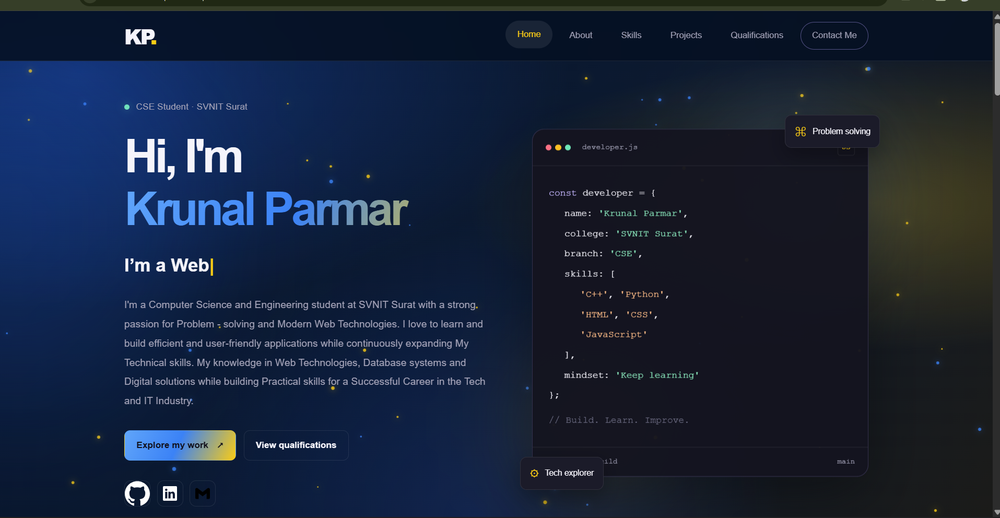
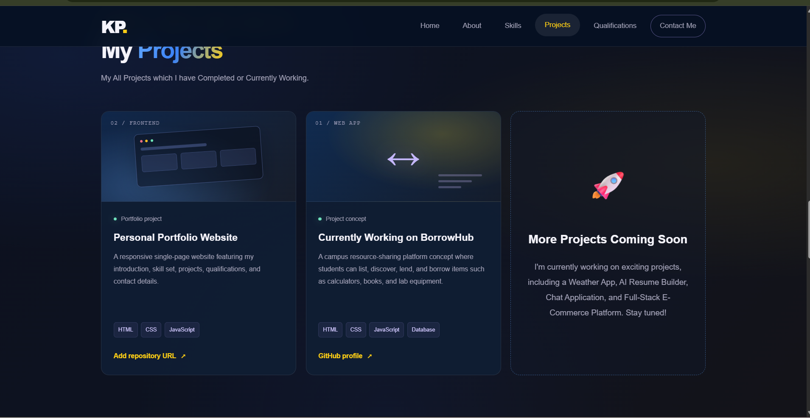
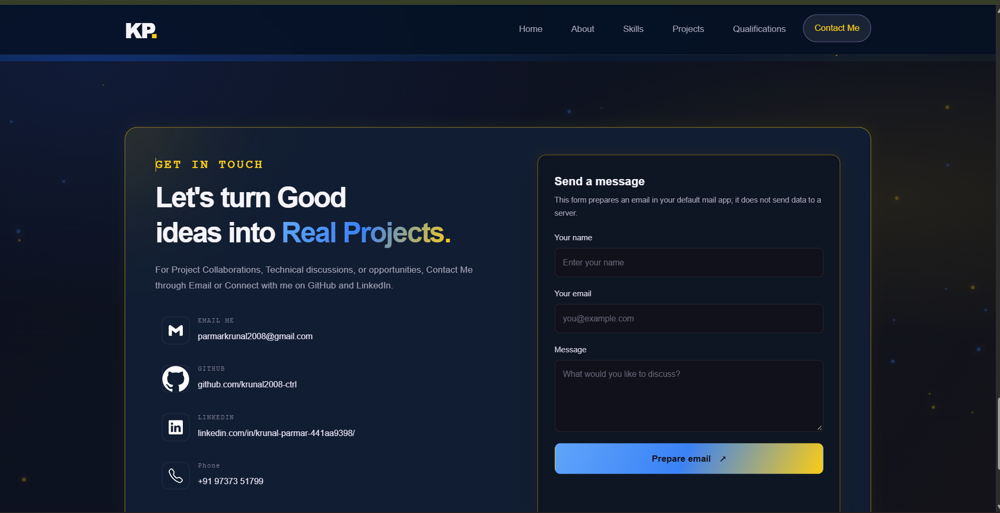

# Krunal Parmar — Personal Portfolio

A responsive, single-page portfolio built with HTML, CSS, and vanilla JavaScript. It introduces me, summarizes my skills and education, showcases current project work, and provides a contact form.

## Preview

### Home


### Projects


### Contact


## Features

- Responsive single-page navigation: Home, About, Skills, Projects, Qualifications, and Contact.
- Blue-and-yellow gradient background with optional animated particles.
- Hover states, scroll-reveal effects, and a typing animation.
- Skills grouped into horizontal category rows.
- Project cards for the Personal Portfolio and BorrowHub, plus a “More Projects Coming Soon” panel. BorrowHub is labelled as in development.
- Qualifications summary and a resume download link.
- Contact form wired to Formspree using its plain-JavaScript AJAX library.
- Email, GitHub, LinkedIn, and phone links.

## Run locally

1. Open this folder in VS Code.
2. Start the website with the Live Server extension, or serve the folder with any static HTTP server.
3. Open the local URL provided by your server.

Most of the layout is local, but remote icon assets and Formspree submissions require an internet connection.

## Personalize before publishing

- **Resume:** Put your real PDF at `assets/Resume.pdf`. The download button points to this exact path. The PDF was not included with the supplied source files, so add it before publishing if you want the download to work.
- **Contact form:** The form uses Formspree form ID `xzedgydo`. Confirm that this is your own active form in the Formspree dashboard and test a submission from the deployed website.
- **Project links:** The current links lead to the GitHub profile/repositories page because specific project repository URLs were not supplied. Replace them with the exact repository URLs when available.
- **Project descriptions and skills:** Keep them accurate to work completed and technologies currently being learned.
- **Screenshots:** The screenshots are recent portfolio previews. After applying these source fixes, review them against the live page and recapture them if the final appearance differs.

## Deploy

This is a static website and does not require a build step. It can be deployed through a static hosting service such as Vercel. Connect the GitHub repository, select the `Other` framework preset, and leave the build command empty. Ensure `index.html`, `style.css`, `script.js`, `assets/`, and `screenshots/` are in the deployed root.

## Project structure

```text
personal-portfolio/
├── index.html
├── style.css
├── script.js
├── README.md
├── .gitignore
├── assets/
│   └── Resume.pdf              # Add your own PDF here
└── screenshots/
    ├── 01-home.png
    ├── 02-projects.png
    └── 03-contact.png
```
